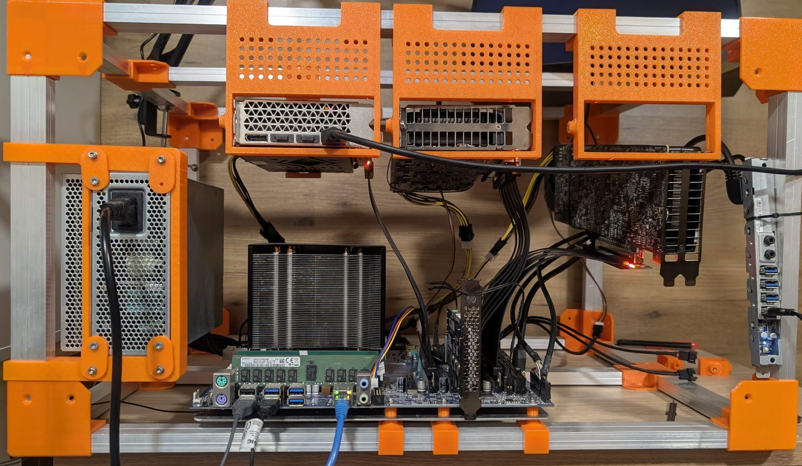
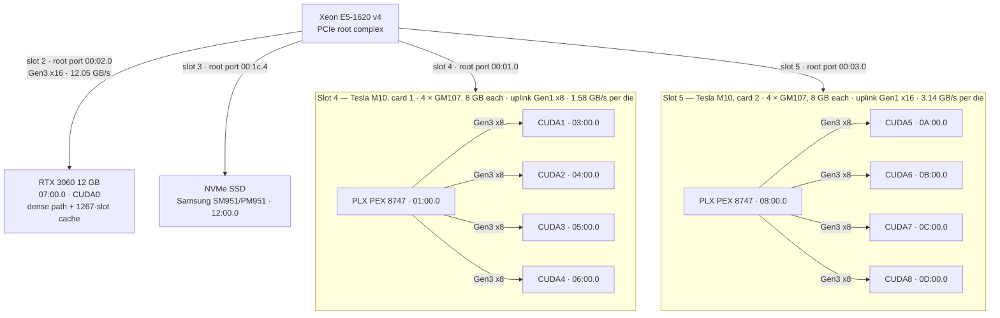

# AIDROGEN — a 125B MoE on a used workstation: RTX 3060 + two Tesla M10

**by [Craicek](https://github.com/BitMakerMan)** · branch `iq3` · November 2026

This is **Qwen3.8-Flash-Next IQ3_S** (125B total, 6B active per token) served from a used HP
Z440: an RTX 3060 runs the dense path and holds a 1267-slot expert cache, and two Tesla M10 cards
hold the remaining routed experts across **eight Maxwell dies**. It serves **128k context**, needle
found at 119,275 tokens, at **54.3 tok/s** against 60.3 for IQ2_XS on the same bench — about 10%
slower, in exchange for the highest-quality quantization of the model. In production since
2026-11-08, tag `aidrogen-prod-2026-11-08`; *aidrogen* is the rig's name.

## The rig



*The rig, open on its aluminium frame: the RTX 3060 and the two Tesla M10 in orange 3D-printed
brackets, on risers above the HP Z440 board and its Xeon heatsink; the ATX power supply is at the
far left.*

## Topology

Everything below was measured on this machine; the raw evidence is
[results/66-pcie-slots-and-links.txt](docs/iq3/results/66-pcie-slots-and-links.txt). Each card is a
PLX PEX 8747 switch with four GM107 dies behind it, 8 GB each.



The dies train **Gen3 x8** with their own PLX switch, but both switch uplinks stay at
**2.5 GT/s (Gen1)** even under load — a BIOS setting from the operator, and the bandwidth
measurement confirms it: 1.58 GB/s per die through slot 4's x8 uplink, 3.14 GB/s through
slot 5's x16, against 12.05 GB/s for the 3060. The reason for Gen1 is in the
[guide](docs/iq3/README.md#2-hardware).

CUDA order: `CUDA_VISIBLE_DEVICES=4,0,1,2,3,5,6,7,8` puts the 3060 at CUDA0 and the eight dies
at CUDA1–CUDA8; the engine runs with `--maxwell-devices 1,2,3,4,5,6,7,8`.

## Results

| | IQ2_XS (upstream reference) | IQ3_S (this fork) |
|---|---:|---:|
| city, 3 runs | 56.60 tok/s | **51.30 tok/s** |
| code, 3 runs | 63.97 tok/s | **57.30 tok/s** |
| **mean, 6 runs** | **60.28 tok/s** | **54.30 tok/s** |
| 128k context, 119,275-token prompt | — | prefill **178.4 tok/s**, decode **44.7 tok/s**, needle found |
| load to `/health` | 640 s (pack on HDD) | **251 s** (pack on SSD) |

Protocol, in a line: city and code, 3 runs each, thinking on, `--max-tokens 600`, temperature 0,
same binary `e1de86e8` for both models, layer profiler off
([results/57](docs/iq3/results/57-bench-i7-summary.txt),
[128k](docs/iq3/results/62-longctx-i8-128k.json),
[load](docs/iq3/results/61-final-i8-production-verified.md)); the two load times read different
storage, so that row is not like-for-like.

**IQ3_S is about 10% slower than IQ2_XS, in exchange for the highest-quality quantization of
the model** (0.90× on this bench).

At load, production holds: a **1267-slot** expert cache on the 3060 (2.45 GiB, pre-filled in
4.4 s), **eight** Maxwell tiers of 2914/2913 experts (**5.54–5.56 GiB per die**), **23,309**
expert blobs round-trip verified (worst relative error 1.18e-02 to 1.29e-02), and 1332 MiB free
on the 3060 with everything loaded. The whole config is one JSON file, kept at mode 0600 on
the rig.

## What this fork adds, and what comes from upstream

| Ours — branch `iq3` | Upstream — the credit is theirs |
|---|---|
| **Eight M10 dies** on the whole-expert path, two cards instead of one. The E1 and tensor paths stay 4-way by construction and refuse more. | **[Strata](https://github.com/Niko1221/Strata)** by **Niko1221** — the engine, the server, the CUDA backend, the whole architecture. |
| **IQ3_XXS, IQ3_S and IQ4_XS gate/up kernels** for Maxwell, transcribed from the 3060's IQ dot products and verified against them to 1e-5 relative. | **[Strata-maxwell](https://github.com/nuke1984/Strata-maxwell)** by **nuke1984** — the Maxwell tier this fork extends: whole-expert split, S2/Q2_0 down, IQ2 gate/up kernels, round-trip gate, safety guards, the 4-die implementation. |
| A **native, planar IQ4_NL down** for the Maxwell tier: the down stage went from 271 to 118 µs/layer (−56%), with a bit-for-bit dump proving the repack is lossless. | **[Qwen](https://github.com/QwenLM)** — the Qwen team, for Qwen3.8-Flash-Next. |
| A per-layer `(gu_type, d_type)` dispatcher, an extended parity tool, a bench/power/profile toolchain, and the whole campaign in [docs/iq3](docs/iq3/README.md). | **[ISTA-DASLab](https://github.com/ISTA-DASLab)** — the GSQ-RCO quantization and the IQ3_S pack this runs; **[ggml / llama.cpp](https://github.com/ggml-org/llama.cpp)** — the `block_iq*` types, their reference dequantization, and the dot-product layouts the kernels follow. |

## Read more

- **[docs/iq3/README.md](docs/iq3/README.md)** — the full guide: hardware, software, the
  bench protocol, the measurements, the known limits.
- **[docs/iq3/LOG.md](docs/iq3/LOG.md)** — the campaign log, one entry per iteration.
- **[Reproduction](docs/iq3/README.md#5-reproducing-it)** — build, configure, serve and
  re-measure it.
- **[LICENSE](LICENSE)** — MIT, as upstream.

---

## Upstream: Strata-Maxwell by nuke1984

# Strata-Maxwell

An optimization of **[Strata](https://github.com/Niko1221/Strata)** for a fixed rig: **NVIDIA
RTX 3060 12 GB + Tesla M10**, serving the **Qwen3.8-Flash-Next** MoE (24,576 routed experts,
~33.7 GB quantized).

This is a **proof of work**: it checks whether the Tesla M10 — a cheap, everywhere-available
datacenter cast-off — can usefully offload MoE routed experts. The goal is M10-based expert
offload for medium-big MoE models.

## Why the M10

In October 2026 the Tesla M10 sells for about **$100-120 on the backmarket** and carries
**32 GB of GDDR5** — memory cheaper per GB than DDR4 system RAM, on a single board. If it can
hold a model's routed experts, medium-big MoE models become affordable to serve.

## The architecture (fixed)

**Hardware (one rig, nothing varies):**

- **RTX 3060 (Ampere)** — the dense spine: attention, dense layers, the KV cache (k8v4), the
  MTP draft head, PLE — plus a **1874-slot routed-expert cache (2.53 GiB)**.
- **Tesla M10** — four Maxwell GM107 dies, ~7.6 GiB usable each = **30.5 GB expert tier**,
  holding the **other 22,702 routed experts**, resident in VRAM at load.
- **Host** — 4-core AVX2 CPU, 39 GB RAM. In production it holds no experts at all.

**Software:**

- Base: upstream **Strata v0.2.6** (engine 0.1.51), branch `maxwell-0.2.6`, tag
  `maxwell-0.2.6-port-production-OK`.
- The **Maxwell tier** (new): loads the profile-ranked routed experts into the M10 dies at
  start, verifies every blob with a round-trip quantization gate, and serves all 3060-cache
  misses from M10 VRAM — no file reads, no page cache, fully deterministic.
- Six environment knobs tune the tier: `STRATA_MW_MT`, `STRATA_MW_MT_T`, `STRATA_MW_NTM`,
  `STRATA_MW_TWOPHASE`, `STRATA_MW_AD2H`, `STRATA_MW_FASTCOMPLETE`.
- MTP speculative decoding (spec 6); PLE n-gram lookups over direct I/O.

How to build and run it: **[docs/MAXWELL.md](docs/MAXWELL.md)**.

**The M10 tier was written with GLM 5.3 (Z.ai).**

## The test: M10 VRAM vs CPU RAM

**The test's specific purpose: serve the model at its full 256K context.** At that context the
KV cache consumes most of the 3060's 12 GB, leaving only ~2.5 GiB for experts — so **22,702 of
the 24,576 routed experts (92%) must be offloaded**, and their main load falls on the M10
(setup A) or on host RAM (setup B). This is the particular test that measures the effective
cost of offloading experts, and whether the M10's 32 GB can carry most of a big MoE's experts.

```text
                       prompt
                          |
                          v
          +---------------------------------+
          |  RTX 3060 (sm_86)               |
          |  dense spine, KV k8v4, MTP      |
          |  expert cache: 1874 experts     |
          +---------------------------------+
                          |
      cache misses: the other 22,702 experts
             |                         |
             v                         v
   +-------------------+     +-------------------+
   | setup A           |     | setup B           |
   | Tesla M10         |     | CPU RAM           |
   | 4x GM107, 30.5 GB |     | 32.2 GB locked    |
   | resident tier     |     | resident copy     |
   +-------------------+     +-------------------+
```

Same host, same model, **equal expert split** — the one comparison that counts, both sides
fully deterministic (every expert in real memory, no page cache, no file reads after load).

| | **Setup A — M10** | **Setup B — CPU RAM** |
|---|---|---|
| context | **256K** (the model's full length) | **256K** (the model's full length) |
| KV cache | k8v4 | k8v4 |
| binary | this repo | stock upstream v0.2.6 |
| recipe | production (spec 6, min-p 0.5, spec-split + knobs) | stock (spec 4 default) |
| 3060 expert cache | 1874 experts | 1874 experts (identical, log-verified) |
| the other 22,702 experts | **M10 VRAM**, resident at load | **page-locked host RAM**, resident at load |
| PLE | direct (pinned explicit) | direct (pinned explicit) |

Protocol: three fresh 2.7k prompts + one 10k diverse prompt (all 0-reused, verified in the
engine logs), two 300-token greedy decodes, full quality gates on both sides — all green.

| tok/s (engine-log) | **Setup A — M10** | **Setup B — CPU RAM** |
|---|---:|---:|
| prefill 10k diverse | 154.3 | 275.3 |
| decode, 300 tokens | **70.1** | 52.5 |

Decode shown at steady state: the M10 is flat run to run (69.5 / 70.1); the RAM side's first
run (35.9) is its VRAM cache adapting, not steady speed. Every run, gate and load-log line:
**[the detailed benchmark record](bench/results/2026-10-25-m10-vs-standard/README.md)**.

**Verdict:** with the experts in M10 VRAM, decode runs at ~1.3× the warm CPU-RAM rate
(70.1 vs 52.5) — flat from the first run, fully deterministic, and leaves all 39 GB of host
RAM free. Host RAM wins prefill (~2.8× on fresh 2.7k prompts; the CPU's wide prefill windows
against the M10 tier's 64-token windows). For interactive serving the M10 tier is the
production choice on this rig.

The implication goes past this one rig: good results with the experts offloaded to an M10
**open the way to very cheap serving hardware** — a $100 cast-off card carries the experts —
and **free the host's CPU and RAM for other compute**.

## Limits & open questions

- Measured on exactly **one rig and one model** (Qwen3.8-Flash-Next, IQ2_XS pack). No other
  model, host GPU, or M10 count has numbers behind it.
- The M10 tier prefills in 64-token windows: host RAM wins prompt speed ~2.8× (measured);
  decode is where the M10 pays (~1.3× warm, flat from the first run). Prompt-heavy, decode-light workloads would pick B.
- A full load takes ~4-6 minutes; the tier must see the M10's dies as CUDA devices with
  enough free VRAM (verified at load — the engine refuses to serve half-loaded).

## Use it freely

The code is MIT licensed, same as Strata (see [LICENSE](LICENSE)). Fork it, run your own
experiments — other cards, other MoE models, other expert splits, other context lengths — and
treat `bench/results/` as the template for recording what you measure (the protocol script is
[`bench/prefarm.py`](bench/prefarm.py), the index is
[`bench/results/README.md`](bench/results/README.md)). Contributions and reproductions are
welcome.

Full records: [`WORKLOG.md`](WORKLOG.md) and the [`bench/results/`](bench/results/) index.
